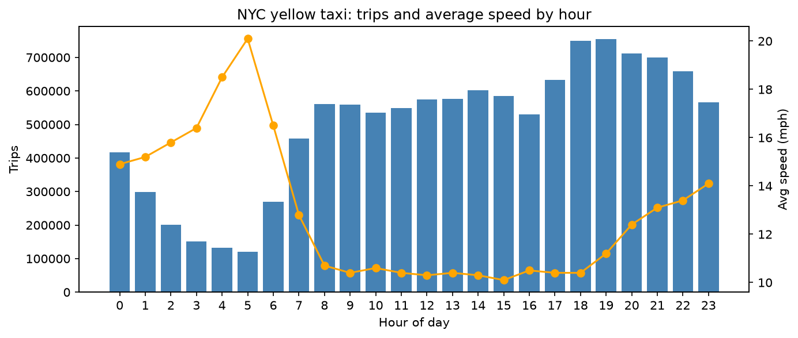

# nyc-taxi-spark-pipeline

A small PySpark project that turns a raw NYC Yellow Taxi CSV (~12 million trips) into clean, enriched data using the **medallion architecture** (bronze → silver → gold). Built as a hands-on way to learn Apache Spark, running locally.

## What it does

| Stage | Purpose | Output |
|-------|---------|--------|
| **Bronze** (raw) | Read the CSV and store it unchanged as Parquet | `lake/bronze` |
| **Silver** (clean) | Drop nulls, invalid values (negative fares, zero distances, impossible timestamps), out-of-range coordinates and duplicates | `lake/silver` |
| **Gold** (rich) | Add derived columns (duration, speed, hour, weekday, tip %), join a payment-type lookup table, aggregate by hour and payment type | `lake/gold/trips`, `lake/gold/by_hour` |

Spark features covered: reading CSV with schema inference, Parquet read/write, `filter`, `withColumn`, `groupBy().agg()`, `join`, Spark SQL and window functions (extra cells).

## Results

March 2016 data:

- 12,210,952 raw rows → 11,951,380 after cleaning (2.1% dropped) → 11,896,623 after the gold filters
- The busiest hours are 18:00-19:00 (~750k trips each); the quietest is 05:00 (~121k)
- Traffic shows clearly in the data: average speed is ~10 mph between 09:00 and 17:00 and rises to ~20 mph at 05:00
- Credit-card trips leave an average tip of ~22%. Cash tips are not recorded in the data, so they are excluded from the tip calculation



## Dataset

[NYC Yellow Taxi Trip Data](https://www.kaggle.com/datasets/elemento/nyc-yellow-taxi-trip-data) on Kaggle. This project uses a single file, `yellow_tripdata_2016-03.csv` (~1.9 GB). The data is **not** included in this repo; download it and place it in `data/`.

## Requirements

- Python 3.12
- Java 17 or newer (PySpark 4.x does not work with Java 8)
- On Windows only: `winutils.exe` and `hadoop.dll` (Hadoop 3.x) in `C:\hadoop\bin`, needed for Spark to write files
- About 8 GB of RAM (the notebook sets `spark.driver.memory` to 4 GB)

## Run it

```bash
python -m venv .venv
# Windows: .venv\Scripts\Activate.ps1      Linux/Mac: source .venv/bin/activate
pip install -r requirements.txt
```

Put the CSV in `data/`, open `pipeline.ipynb`, select the `.venv` kernel and run all cells in order. The first two cells (Hadoop setup and Spark session) must run before anything else. The CSV → bronze cells only need to run once.

## Project structure

```
nyc-taxi-spark-pipeline/
├── pipeline.ipynb            # the whole pipeline
├── hourly_trips_speed.png    # chart produced by the last cell
├── requirements.txt
├── data/                     # input CSV (not in the repo)
└── lake/                     # generated Parquet: bronze, silver, gold (not in the repo)
```
